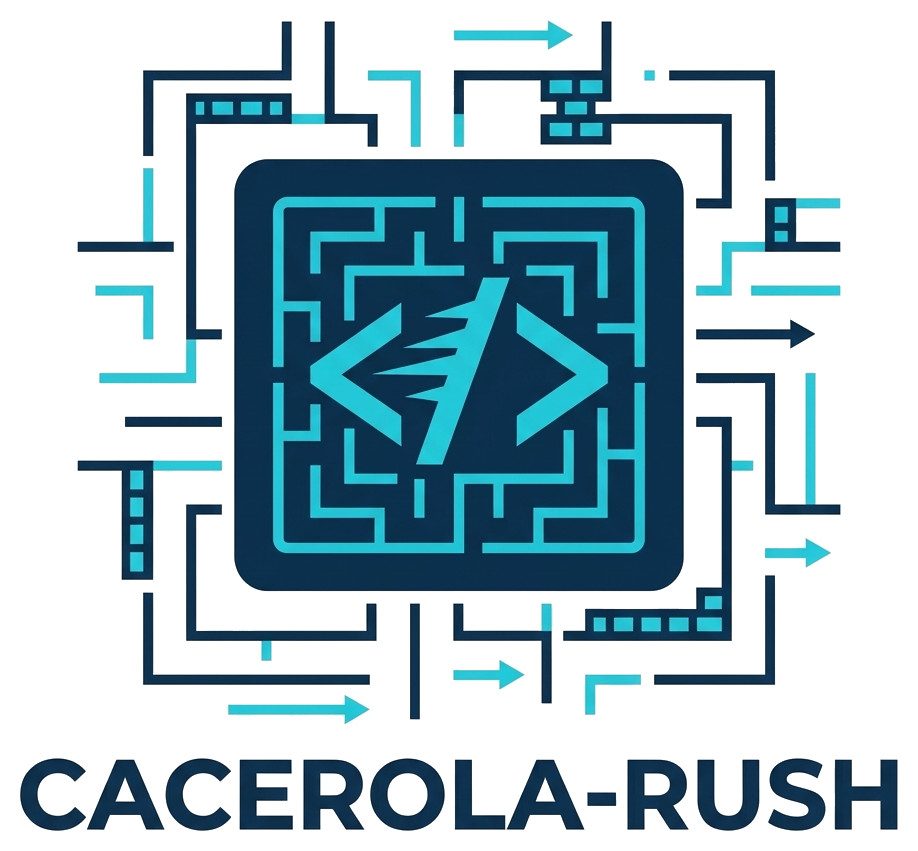

<h1 align="center"> Cacerola-Rush </h1>

 
<!-- TABLE OF CONTENTS -->
<h2 id="table-of-contents">📑 Table of Contents</h2>

Table of Contents

<li><a href="#about-the-project">  The Project</a></li>
<li><a href="#used-technologies">  Technologies</a></li>
<li><a href="#contributors">   Contributors</a></li>
<li><a href="#documentation">   Documentation</a></li>
<li><a href="#download">    Download</a></li>

 
 
<!-- ABOUT THE PROJECT -->
<h2 id="about-the-project"> 🔎 About The Game</h2>

The Maze project is an interactive C++ console-based game where the player navigates through a dynamically generated labyrinth. The primary objective is to travel from the starting position at the top-left corner (0,0) to the exit located at the bottom-right corner.
Key features include customizable grid dimensions ranging from 10x10 up to 50x50 using dynamic memory allocation, procedural maze generation on every application run, real-time keyboard navigation with wall collision checks, and integrated high-score tracking.

</td></tr></table>

<h2 id="used-technologies"> 🧑‍💻 Used Technologies </h2>

-  <a href="https://visualstudio.microsoft.com/vs/">Visual Studio 2022</a>
 
-  <a href="https://github.com/">GitHub</a>
 
-  <a href="https://en.wikipedia.org/wiki/Microsoft_Word">MS Word</a>
 
-  <a href="https://bg.wikipedia.org/wiki/Microsoft_PowerPoint">MS PowerPoint</a>
 
-  <a href="https://www.microsoft.com/en-us/microsoft-teams/group-chat-software">MS Teams</a>

------------------------------------------------------------------------------------------------------------------------------
- Programming language:    <b>C++</b>

 
<!-- CONTRIBUTORS -->
<h2 id="contributors">👥 Contributors</h2>

 
<b><a href="https://github.com/SACHapkina24">Sofia Chapkina (9V🟩) - QA</b> 
 
Email: SACHapkina24@codingburgas.bg

<b><a href="https://github.com/GIHristov24">Georgi Hristov (9G🟦) - Backend Developer</b> 
 
Email: GIHristov24@codingburgas.bg
 
<b><a href="https://github.com/DGBornusuzov24">Dimitur Bornusuzov (9G🟦) - Scrum Trainer</b> 
 
Email: DGBornusuzov24@codingburgas.bg
 
<b><a href="https://github.com/IMKrylov24">Ian Krylov (9A🟨) - Frontend Developer</b> 
 
Email: IMKrylov24@codingburgas.bg
<h2 id="documentation">📄Documentation</h2> 

 <a href="https://1drv.ms/w/c/521bb4d4f71743d0/IQCMggkmNb6LQbIyX3wr04uzAbhGjKd060LgAnRM9F9LKpA?e=ko3qoG">Documentation</a>
 
 <a href="https://github.com/DGBornusuzov24/Cacerola-Rush/blob/main/docs/Cacerola%20Rush%20presentation.pdf">Presentation</a>
 

<h2 id="download">💾 Download</h2>

To download our project, clone our repository by pasting this command in your command prompt:

<pre align="center">git clone https://github.com/DGBornusuzov24/Cacerola-Rush.git</pre>

<h2 align="center">Thanks for checking out our repo, you can support us by giving our repo a ⭐️!</h2>
